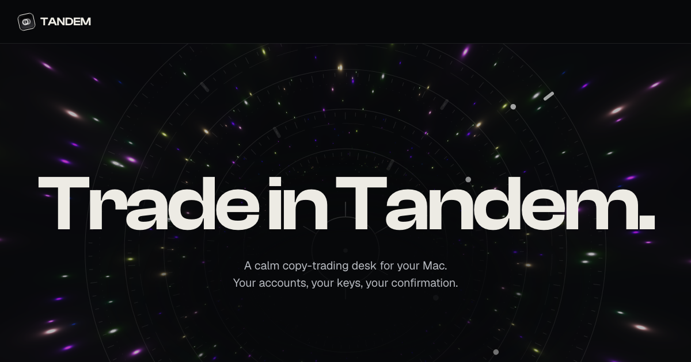
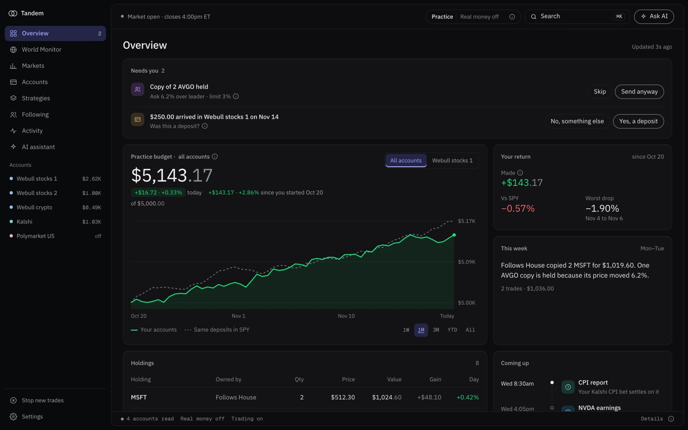

# Tandem for Mac

**[Download for Mac](https://github.com/adersouza/tandem-releases/releases/download/v1.0.61/Tandem-1.0.61.dmg)** · 289.2 MB · [SHA-256](https://github.com/adersouza/tandem-releases/releases/download/v1.0.61/Tandem-1.0.61.dmg.sha256) · [Release notes](https://github.com/adersouza/tandem-releases/releases/tag/v1.0.61)

Follow traders and run your own strategies across five venues from one desk on your Mac.

*Tandem Overview with sample data.*

## What Tandem does

- Follow and copy traders, public wallets or portfolios within your limits.
- Connect supported accounts at Alpaca, Tradier, Webull, Kalshi and Polymarket US.
- Use Claude Desktop, Claude Code, ChatGPT desktop or Codex to research and help run the desk within the access you grant.
- Start in Practice. Use Review → Confirm for orders you approve and Stop to pause new trades.

## Install

1. [Download Tandem](https://github.com/adersouza/tandem-releases/releases/download/v1.0.61/Tandem-1.0.61.dmg) and open the DMG.
2. Drag **Tandem** to **Applications**.
3. Open Tandem from Applications and follow the [quick start](https://adersouza.github.io/tandem-releases/guide/quick-start.html).

Tandem uses Sparkle to check for signed updates. You can also check from Tandem’s Mac menu.

For help, email [contact@monchera.com](mailto:contact@monchera.com).
