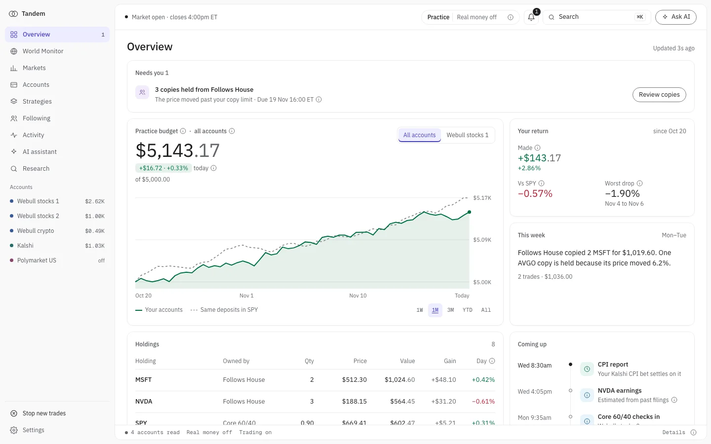
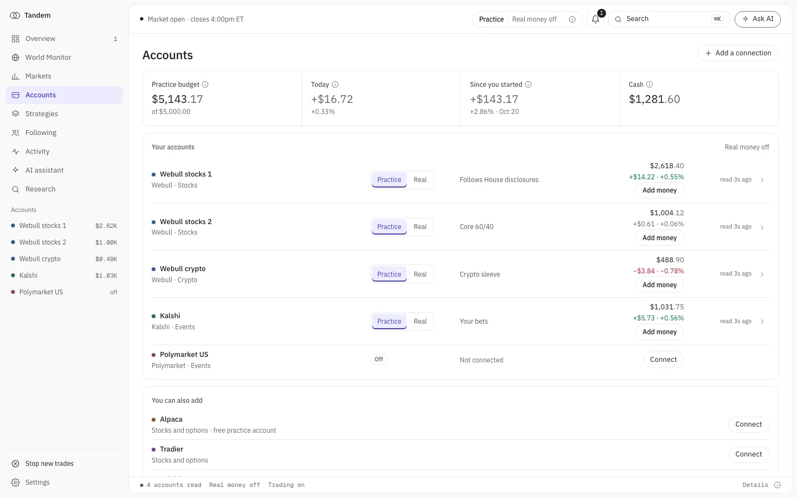
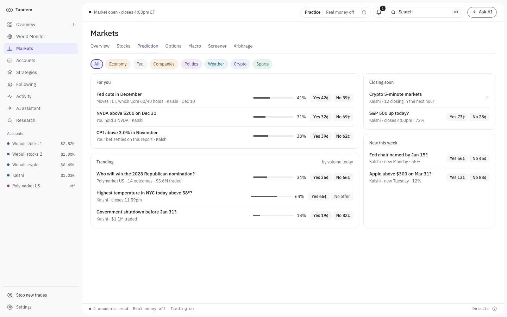

# Tandem client guide

Welcome to Tandem. Start with one account and get to know the desk at your own pace. The screenshots use sample accounts and prices.

[Quick start](quick-start.md) · [Ask your AI](ask-your-ai.md)

[Getting started](#getting-started) · [Connect an account](#connect-an-account) · [Real and Practice](#real-and-practice) · [Add money](#add-money)

[Place and manage orders](#place-and-manage-orders) · [Prediction markets](#prediction-markets) · [Take-profit and stop-loss](#take-profit-and-stop-loss)

[Following and Autopilot](#following-and-autopilot) · [Copy decisions](#copy-decisions) · [Strategies and routines](#strategies-and-routines) · [AI tools for Following and Routines](#following-strategies-and-routines-with-an-ai-app) · [Recurring buys](#recurring-buys)

[Alerts and watches](#alerts-and-watches) · [Needs you](#needs-you) · [Use the AI](#use-the-ai) · [Use a local model](#use-a-local-model) · [Phone access and approvals](#phone-access-and-approvals)

[Stop and caps](#stop-and-caps) · [Research and records](#research-and-records) · [Backups and a new Mac](#backups-and-a-new-mac) · [Privacy](#privacy) · [Troubleshooting and support](#troubleshooting-and-support)

## Getting started

1. Open Tandem on your Mac. On **Connect your accounts**, choose **Take the tour** to explore with sample data.
2. Connect the account you want to use. Use **Not using** for venues you want to skip. Come back to **Settings → Accounts & keys** any time.
3. Read **Your limits** during setup. You can connect an AI app and choose a starting plan, or come back later. A saved starting plan leaves trading off.
4. Start your day on **Overview**. Use **Accounts** for balances, positions and orders. Use **Markets** to find an instrument. Press **⌘K** to search, or **⌘J** to open **Ask AI**.
5. On the Mac, open **Settings → Support → Open Help**. On the phone, use **More → Help**. Use **Search help** to find a topic.

## Connect an account

On the Mac, open **Settings → Accounts & keys → Add a connection**. Choose a venue and the matching environment. Enter the key only in Tandem's connection form. Use **Save and test connection**, or **Save and test** where shown. **Connected** means Tandem read the account. Order permissions, quotes and eligible products depend on the account and venue. If the test fails, open **Manage** and choose **Check now** after reading the reason.

### Alpaca

Choose **Practice** for Alpaca Paper or **Real** for your live account. Choose **Sign in with Alpaca → Open Alpaca**, pick the matching account and approve access. You can also choose **Use an API key** and enter its **Key ID** and **Secret key** from Alpaca.

Use supported stocks, ETFs and options. Eligible accounts can also trade spot crypto. Options approval and short availability come from Alpaca. Basic US stock data can be limited to IEX. Broader data needs the matching subscription. Crypto has its own pairs, fee checks and order limits.

### Tradier

Under Tradier's API Access, copy a sandbox or production token. In Tandem, choose **Tradier → Continue with Tradier**. Select **Practice** or **Real money** and enter the **Access token**.

Use supported stocks, ETFs and options, including eligible multi-leg orders. Check your options level and whether the selected contract and order type are offered. Sandbox quotes are delayed. Live streaming needs Production access. For Tradier research in AI, use Tandem's connection and its approved read tools.

### Webull

In Webull's Developer Console, apply for OpenAPI in the matching environment. Register the app, generate its keys, then enter the **App key** and **App secret** in Tandem. For a live connection, choose **Create token** when Tandem asks. Finish the approval in Webull under **OpenAPI Notifications**, then return to Tandem.

Use eligible stocks, ETFs, options, spot crypto, dated futures and event contracts. Each product needs the matching account and venue permissions. Paper support is narrower. Stock, options and futures quotes may need separate OpenAPI data access. A Webull connection alone leaves these permissions as they were.

### Kalshi

Choose **Demo** for Practice or **Real** for a verified live account. Create a matching API key on the Kalshi site with Read and Trade access. Enter the **Key ID** and use **Choose file** for the private key. Use **Save and test**.

Use Kalshi to trade supported event contracts. Demo and live keys are separate. Subaccounts and advanced order tools appear only where the account supports them. A working event account does not give access to Perps.

### Kalshi Perps

Turn on **Kalshi Perps** under **Settings → New features**. Get the Perps account approved on the matching Kalshi site. Use **Add a connection → Other connections → Kalshi Perps**. Choose the environment and enter its **Key ID** and **Private key**.

Use the separate Perps account for perpetual futures. Check the collateral, leverage, funding and liquidation details. Both Practice and Real need Perps access for that environment. An Events Demo account cannot supply it.

### Polymarket US and Polymarket International

Finish setting up **Polymarket US** in its iPhone app. Create a key in its developer portal. In Tandem, select **Polymarket US** and enter the **Key ID** and **Private signing key**. The second field takes the Secret Key from the portal. Use **Save and test connection**.

Polymarket US is the live venue for supported orders. It has no Practice account in Tandem. Polymarket International supplies public market and wallet research. It needs no trading connection in Tandem. Switch to a supported US venue for an order. An international wallet signal needs an exact tradable contract match before it can be copied.

For the full entry fields and venue-specific steps, see [Connect your accounts](connect-accounts.md), [Kalshi](kalshi.md) and [Polymarket](polymarket.md).

## Real and Practice

**Practice** uses a supported venue's simulated balance. **Real** uses funds at the venue. Start with Practice if you want to try the flow. Some products and venues have no Practice path. Sample Tour and Practice simulations are separate from connected accounts.

The **Practice | Real** choice in the display lets you see that set of accounts and records. Open an account in **Accounts** to find its own **Practice | Real** trading control. Real money starts off. Only you can choose **Real** and confirm it on that account. Connecting, funding, restoring a backup and passing a check leave Real off if it was off. Readiness checks help you decide. Tandem still checks each order when it sends.

### Ask AI about Overview and Accounts

Ask for a summary, or select an account in your connector and ask Tandem to check it. `tandem_brief` summarizes the accounts in your connection's read scope. `holdings_and_accounts` offers `check_account` for the current sourced snapshot and `value_history` for the account's chart points. Practice history uses the saved Tandem budget. Real history comes from the venue where available. If a venue supplies intraday history, ask for it with `intraday: true`. If the history is unavailable, ask AI to explain the reported reason.

Use `funding` to find the selected account's funding steps and `rules` to read its saved limits. Confirm manual order proposals and any change to Real in Tandem. The selected account, saved grant, caps and Stop still apply when AI has Automatic permission.

For an Alpaca account, ask AI to check borrowing availability for a symbol. The connector uses `find_capability` with `alpaca_data` and the `locate_quote` resource. A paid share reservation uses the fee review in Tandem.

If an order outcome is unknown, use `holdings_and_accounts` with `unresolved_orders` to read what Tandem has recorded for that account. Use **Accounts** or **Needs you** in Tandem to check with the venue and reconcile the order.

If a saved cash change needs an answer, choose **Classify cash** on that account’s Cash row.
The question names the account, amount, and day.

## Add money

In **Accounts**, choose **Add money** on an eligible connected account. You can also find it on the account page or in **More**. It takes you to the venue. Finish the deposit there, and wait for spendable buying power. Then use **Check account** to refresh the record. Your trading permission and saved caps stay separate from funding.

Use Kalshi **Transfers** for events and the Perps account's **Deposit** for Perps. Use **Funds & Wallet** in Alpaca, **Transfer Money** in Webull, **Funding** in Tradier or the Polymarket US iPhone app. Practice accounts use simulated funds. [Fund your accounts](fund-your-accounts.md)

Ask your AI where to add money for the selected account. It can use the **funding** action in `holdings_and_accounts` in Research mode to read that account's venue link and instructions. Finish the funding steps at the venue. If the selected connection has been removed, choose a connected account in Tandem.

**Settings → New features → Money movement** is off by default. Where supported, it opens the venue to move money using a destination saved there. Use the venue to check the transfer.

## Place and manage orders

For AI access to market data, ticket details, chart layouts, stars and screener schedules, read the Markets guide through `desk://guide/markets` or `desk_overview` with action `guide` and topic `markets`. [Markets guide](markets.md)

Choose the exact account and instrument. Review the side, quantity, order type, price, fees and available cash. For a manual order or change, use **Review order** or the review action shown, then confirm with the action on the sheet, such as **Place order**. Real and Practice are shown in review. Check the saved status in **Accounts** or **Activity**. An accepted order can still be waiting for a fill.

- **Stocks and ETFs.** In **Markets → Stocks**, open a symbol and choose **Trade**, then choose **Buy** or **Sell**. Choose an account, and enter shares or the supported dollar amount. Fractional shares, extended hours, short sales and replacement orders depend on the venue and ticket. Use a limit price when you want a price boundary.
- **Options.** In **Markets → Options**, choose an underlying, expiry and strike. Pick a call or put and the leg's opening or closing action. For a supported spread, check every leg, the quoted debit or credit and the contract multiplier. Opening permission, the supported order types and the facts Tandem can verify depend on the account and contract.
- **Spot crypto.** From the connected Alpaca or Webull account, open its order ticket and choose the supported coin pair. Check the amount, fee and price shown in review. A coin pair uses spot units. A Perps position uses separate collateral and may use leverage.
- **Dated futures.** Use the order ticket for a Webull futures account and choose the exact contract month. Read the contract size, quote, margin and fees before reviewing. Use only the order types and controls offered for that account.
- **Perpetual futures.** Open **Accounts → Kalshi Perps**. Choose **Trade Perps** to select the contract, direction and size. Check leverage, collateral, funding and the liquidation information shown. Check that a reduction is marked as a reduction before you confirm.
- **Event contracts.** Use **Markets → Prediction** or the supported Webull Event account ticket. Follow the steps below for settlement terms and prices.

Open the account's working orders to find **Change** or **Cancel** where supported. **Change** opens a review. **Cancel** sends a cancellation request without order review. Read its actual result. An order can fill before a change or cancellation takes effect. If status is **Unknown**, check the venue and reconcile before trying again.

For a working Polymarket US limit order, ask your AI to read the exact order before preparing a price change. The **polymarket_order_terms** action in `holdings_and_accounts` reads the selected account's order with its current terms and revision. Preparing or confirming a change still requires the account's trading checks.

If a control is missing, check **Settings → New features** for **Options trading**, **Stock ticket extras** or **Queue for the open**, depending on the order. When offered, **Queue for the open** lets you review a Webull order for the next session. In **Accounts → More**, look for available tools such as **Stock borrowing**, **Fills and settlements** and **Batch orders and cancel all**. Your account and the venue decide which tools appear.

### Batch orders and share reservations

- **Polymarket US.** On the Mac, open the account and choose **More → Batch orders and cancel all → Batch orders**. Use **Place orders** for new orders or **Edit orders** for working orders. Check each row and the combined amount in Review. Use the **Place** or **Change** action for the group. With **Cancel orders**, select exact orders and choose **Cancel selected** or **Cancel _n_ selected**. Read the result for each order.
- **Polymarket US cancel all.** In a connected AI app, find **polymarket_cancel_all_review** for the selected account. Review the exact working orders in Tandem and confirm the cancellations. On the Mac, **More → Fills and settlements → Cancel all orders** sends cancellation requests immediately. If the working set changes, read it again before retrying.
- **Kalshi.** On the Mac, open the account and choose **More → Batch orders and cancel all → Batch orders**. Enter the market code, action, contracts and limit for each bet. Check the count and total and choose **Place _n_ bets**. Read each result before retrying. The batch page also shows the cancellation action for the selected account’s working orders.
- **Alpaca.** Enable **Paid stock borrowing reservations** in **Settings → New features**. On an eligible Real account, open **More → Stock borrowing**. Enter **Stock symbol** and choose **Check availability**. If a paid locate is offered, enter **Shares to reserve** in multiples of 100. Choose **Review fee** and check the share count and maximum fee. **Accept fee** reserves shares if Alpaca confirms. Place any short separately from the trade ticket.

## Prediction markets

In **Markets → Prediction**, browse categories or search for an event. Open its market or series. Read the exact outcome, cutoff and settlement source. A similar title on two venues can cover different terms. Use **Yes** or **No** for the outcome, then check the selected Kalshi, Polymarket US or eligible Webull Event account in the ticket.

Check the price, contracts or spend, fees, and payout if shown. Choose the ticket's review action and confirm only when the terms match what you want. To exit, find your held contract and use the supported sell or reduce action. Check settlement from the venue record once it is final. **Markets → Arbitrage** helps compare markets. A difference in quotes does not establish a fill, a matched settlement or a profit.

Use **Browse Kalshi** or **Browse Polymarket US** for the venue's market list. Advanced tools such as **Kalshi combos and quotes** and **Polymarket quotes and combos** depend on account access and **New features**. Read which outcomes must win before reviewing a combo. A price request by itself leaves you without a fill.

## Take-profit and stop-loss

Use the protection controls on an eligible stock or options ticket. On supported stock orders, **Protect this trade** opens the exit fields. For supported held shares, use **Protect** when offered. In the Webull options ticket, look for **Attach take-profit and stop-loss**. Check the prices and exact quantity in the review. Some venues offer extra exit controls on the account page, including stop and target triggers on eligible Perps positions.

A take-profit sets a target price. A stop-loss triggers an exit when its rule is reached. A stop-limit can trigger and still wait for a fill. A venue-held exit can keep working while your Mac is offline. Check the venue's order status and both legs of a linked pair. Gaps, a fast market or a cancellation race can change the outcome.

## Following and Autopilot

Open **Following → Follow a portfolio**. See what the source actually reported and when. Eligible portfolios can show **Save copy** and a destination account. Choose the account carefully. Saving the copy leaves trading off. Open the strategy and review its allocation, limits and permission before enabling it.

- **Congress and funds.** Use **Source details** to check the filing and its age. A disclosure can arrive long after the trade. A fund's quarterly filing is a snapshot of what it reported at that date.
- **Wallets.** Follow public wallet activity as a signal. Use **Start practice mirror** where offered to simulate, or **Review a trade → Ask AI in Review** to prepare a supported order. Choose a destination account and **Maximum spend (USD)**. Old follows can show **Track new trades**. A wallet signal waits if Tandem cannot match the exact contract and verify the needed trade and book details.
- **Autopilot and model portfolios.** Autopilot public summaries are for watching where available. They are partial and do not power a live mirror. A complete supported model import needs its own source and timestamp. In **Following → Allocation**, Tandem's own allocation policy shows how it splits a budget among selected strategies. Review caps and rebalance settings before using it.

Use **Copy safety** to check signal age, price drift, spread and available depth. Even a saved automatic copy can wait if one of those checks fails. [Presets and traders](presets-and-traders.md) · [Webull and model following](webull-and-model-following.md)

Supplemental Congress data comes from the [CapitolStockWatch Research Desk](https://www.capitolstockwatch.com/) under [CC BY 4.0](https://creativecommons.org/licenses/by/4.0/). Tandem normalizes the published rows. In **Source details**, **Needs review** flags records that still need verification against an official filing. Tandem never copies a trade based solely on supplemental data.

Open **Manage follow** on a saved source to stop new copies and keep your current holdings.
Open **History** on a followed wallet to see public activity, including reported combo redemptions.
The public history can omit records.

## Copy decisions

On **Following → You follow**, open **Copy decisions** for a source. Choose **View decision** to read where the signal came from, the planned account and order, the checks and the outcome. Use **Open in Activity** when available to see the saved event. A skipped or held copy may have no order. Read the actual order status to see whether a submitted order filled.

In **Held copies**, you may have **Skip** or **Send anyway**. Use **Skip** to pass. **Send anyway** opens a fresh review for an eligible held copy. Account limits and other safety checks still apply. If a result is unknown, reconcile it before another send.

## Strategies and routines

Open **Strategies → Running** to see what is running and which account it uses. Open **Presets** for ready-made rules or **Practice runs** for simulated results. On a strategy, review its saved policy and enabled state. **Operate with agent**, where offered, scopes the AI to that saved strategy.

Open **Strategies → Routines** to see the schedule and run history. Use **Pause** or **Resume** where offered. **Run now** on a routine that can trade opens a review before it runs. A routine can read sources, prepare a review or act under an approved trading grant, depending on its settings. Keep the Mac awake, signed in and running Tandem for scheduled checks. A pause stops future runs. Check existing orders separately.

Real allocation schedules can submit orders only. Cancel any order still working from its account. Intraday allocation schedules are available in Practice only.

## Following, strategies and routines with an AI app

Use the AI app guide for the exact tools, required permissions and confirmation steps. [Following, strategies and routines with an AI app](ai-how-to.md#following-strategies-and-routines-with-an-ai-app)

## Recurring buys

Open **Strategies → Routines → New recurring buy** on the Mac. Choose **Stock or ETF** or **Crypto**, the symbol and an eligible account. Set **Amount per buy**, **Total cap**, **Frequency**, **Start date** and **End date**. Choose **Save recurring buy**.

Under **Order approval**, choose **Review each buy** to confirm an exact buy when it is due. **Automatic** uses the account’s existing grant where supported. Check **Activity** inside the plan for its next steps and the outcome of each attempt. Open the saved plan to **Pause**, **Resume**, **Edit** or **Delete** it. Raising limits and deleting the plan require confirmation.

## Alerts and watches

- On a supported stock, choose **Alert** to set a price level. Use the alert control where available on a contract. **Settings → Alerts and phone → Price alerts → Manage** is where you can review them later.
- Open **World Monitor → Watches → New watch**. In **Tell me when…**, try “NVDA below $180 and NVDA volume above 25000”. Check the parsed conditions, schedule and delivery. Use **Save watch**. Use the watch’s switch to pause it.
- Under **When it fires**, choose **Alert only**, **Propose an order** or **Automatic order** where offered. For an order, choose the exact account, symbol or market, side, quantity, price limit, frequency and expiry. Use **Review order** when a proposal is ready. Automatic orders need an eligible saved grant. Crypto watch orders use Review. Stop cancels unsent watch orders.
- In **Settings → Alerts and phone**, choose what to receive, including **Needs you items**, **Price alerts**, company filings and news about holdings where offered. Set quiet hours and check that phone alerts arrive.
- Star a stock in search to keep it on the **Markets → Stocks** watchlist. A star keeps the symbol handy. Use a price alert or watch if you want a notification.

## Needs you

Start on **Overview → Needs you** or open the bell. The list can show a held copy, order review, account check, funding need or cap prompt. Read the account and reason on each item. Open its action, such as **Review**, **Check account** or **Add money**, when shown. For an eligible pending item, **Skip** sets it aside. Open **Activity** for the saved outcome. An empty list means there are no items to show from the sources Tandem could read.

Ask your AI to read **Needs you** for its approved account. It can use `alerts_and_health` with **needs_you** to get the item, its reason and the link or action Tandem shows. Open that item in Tandem to act on it. In Overview, choose the number of remaining items to expand the list.

## Use the AI

Open **AI assistant** for chat. Use **Ask AI** for a quick question from another page. Try “What needs my attention?” or “Why was this copy held?” Ask for the source and time. See [Ask your AI](ask-your-ai.md) for more examples.

- **Research** reads and explains within the chosen scope.
- **Review** can prepare a proposal. Open **Open order** or **Review change** where shown and confirm in Tandem if you agree.
- **Automatic** can send eligible orders within a saved grant without asking for every order. For real orders, it needs an account with Real enabled and the account's permission. Review the exact account, optional dollar caps and expiry before granting it.
- **Manage** adds supported strategy or settings changes within its explicit scope. A grant cannot expand itself.

For the built-in assistant, choose a tested provider in **Settings → AI**. **Claude plan via Claude Code** uses your Claude sign-in. API providers use their own key and billing. Check **Which AI does what** for the route each task uses. Paid requests need pricing, budget and your approval.

To use an external AI app, go to **Settings → AI → Connect an AI app**. Use its setup instructions, check that the code in both apps matches, then review what it can read or do. Use **Revoke** beside the app to end its access. In built-in chat, use **Automatic mode and AI settings → Turn off** to end the selected account's automatic permission. Use **Stop new trades** to pause new entries without waiting for a chat reply. [Connect your AI](connect-ai.md) · [MCP setup](mcp-setup.md)

### Ask a connected AI app

- Use `desk_overview.setup` for the connection checklist and `desk_overview.setup_progress` for the saved Setup step and skipped items. Use `alerts_and_health.check_connection` for a saved venue. Enter keys and approve sign-in in Tandem or at the venue.
- Use `desk_overview.preferences` for saved goals, alert choices and World topics. Ask `alerts_and_health.propose_settings` to prepare a change, then review it in Tandem. When changing one alert choice, read the current choices first and carry forward the rest.
- Use `manage_price_alerts.list` for alert IDs. Use `set`, `edit`, `rearm` or `remove` for a price alert. Use `chart` with a saved connection, symbol and condition for an EMA, drawing, bar or settlement alert. For a workspace watch, use `watch.list`, `watch.preview` for a stock-price condition, and `watch.change` with the current revision.
- Use `world.monitor` for saved world headlines and `world.my_news` for news linked to approved holdings. Use `world.timeline` for an exact saved public-event snapshot and cutoff. Use `research.workspaces` and `research.result` for saved workspace research.
- Use `records.activity` for recent saved receipts in the approved account scope. Use `explain.decision` for an exact order, routine run or copy decision. Use `records.statements` to list saved monthly PDFs, then open the document in Tandem.
- Use `desk_overview.phone_status` for the active pairing count and the selected account’s phone approval settings. Check alert delivery from Tandem. Pairing, revocation and approval happen on your device.
- Use `desk_overview.backup_status` for the latest local backup and folder copy status. Use `alerts_and_health.backup_now` to prepare a backup and confirm it in Tandem on the Mac. Choose the folder or restore from Settings. Use `desk_overview.guide` with topic `client-guide` for these steps or `troubleshooting` for support. Save diagnostics in Tandem and email contact@monchera.com if you need help.

Ask for a saved weekly digest by ISO week, a saved research job or World dossier by its exact ID, or a strategy's filing-source status. On a selected Polymarket US account, give the RFQ, quote and side to read maker terms for Review. For a Kalshi block trade, provide both connected accounts. The guide lists the exact tools. [Ask your AI](ai-how-to.md)

## Exact actions in a connected AI app

Use `find_capability` for exact saved-record actions, including classifying a cash question, following a public summary, pausing a Practice mirror and saving a reviewed strategy edit. Ask the AI to use the account, row or version you selected. The guide lists the exact tools and inputs. [Ask your AI](ai-how-to.md)

For native batches, paid stock borrowing and Kalshi cash transfers, open the AI proposal in Tandem to review and confirm the exact terms. Polymarket US Cancel all uses the observed working set and needs the saved cancel grant to run automatically. Read the outcome of each order before repeating an action.

Research can queue selected saved rows, capture the forecast for a reviewed contract, register an original attempt, save a code draft, run a retained Vibe study or prepare an existing World assessor input. Use the saved selections from Research. Code draft intake and World assessor preparation use no inference.

## Use a local model

Install and open Ollama on your Mac. Open **Settings → AI → Default AI → Local model**, then choose **Check again**. Choose a model from **Model**. Use **Download** if needed, then **Use this model**. Choose **Prefer connected AI** to give your connected assistant priority again.

Download size appears beside each model. The local model can answer research questions, prepare proposals for Review and save watch-only follows within the session’s access. Review and confirm proposals in Tandem.

## Phone access and approvals

1. Connect the Mac and iPhone to your private Tailscale network. On the Mac, open **Settings → Alerts and phone**. In **Phone**, find **Approve orders from the phone → Manage**, then choose **Set up phone access**.
2. Choose **Show code**. Open the pairing address shown on the iPhone and enter the code there. It works once and expires in a few minutes. A paired phone stays paired for 30 days. Use **Revoke** beside its name if you lose it.
3. For ntfy notices, use **Pair** in the **Phone** card on **Alerts and phone**. Scan the code with the phone camera. Copy the address and subscribe in ntfy. Choose **Send a test alert** and check that it arrives. A notification points you back to Tandem.
4. Open the saved item from **Needs you** or the notification. An eligible order review can show **Send exact proposal to phone**. On the phone, read the proposal and use the approval action shown, or **Skip** when offered. If it says to finish on the Mac, open the same item there. Venue keys, turning on Real and setting up Automatic stay on the Mac.

## Stop and caps

Use **Stop new trades** in the Mac sidebar or under **More** on a paired phone. It pauses new entries and attempts to cancel resting buys. Read the cancellation results. Positions stay open. Check **Settings → Trading safety → Stop new trades** for the saved state. Review your orders and positions before using **Turn back on…** on the Mac.

Open **Settings → Trading safety → AI and routine order caps**. Expand the account with a saved grant. Use **Set cap** or **Edit cap**, then **Save cap** for **Per-order cap** or **Daily dollar cap**. A higher amount needs **Confirm raise**. Use **Turn off → Confirm turn off** to remove a cap. **No cap set** means that grant has no cap of that kind. Other order checks still apply.

An eligible manual order over a soft cap can offer **Go over once** in Review. It applies to that reviewed order. Your saved cap remains in place. Automatic runs wait at saved caps. A known venue hard cap blocks an order. If the venue has not reported its position limit, Review can show that it is unknown and the venue still decides.

If an AI routine or desk-team run in Trade mode hits a saved dollar cap, review the order on the Mac. To make a one-time exception, use **Go over once** in an eligible manual order review on the Mac.

## Research and records

- **Research → Research library** brings saved studies and research together. **Tests & evidence** shows saved evaluations and practice evidence. **Sources** shows where data came from and whether a read succeeded. Check dates and how results were produced before comparing them.
- **World Monitor → Now** shows sourced headlines and **Watching for you**. Open **Watches** for saved watches. **Markets → Macro** shows sourced releases. On a supported stock page, **Price and history** opens price details. **Your trades on the price** shows recorded trades alongside prices when available.
- **Activity** shows recorded actions and outcomes, including manual orders, copies and AI activity when recorded. Use dates and the Practice or Real view to find the right record. **Weekly digest** shows the saved week when available. Find available venue records in **Settings → Statements**.

### Chart controls

Open a stock or fund in **Markets** and open its chart. Choose the **Interval** and **Chart type**. On a phone, open **Chart tools** for extra controls. On an eligible chart, toggle **Extended hours** or **Log scale**. Open **Compare**, enter the comparison symbol and choose **Add**.

The **TradingView** attribution opens the chart library’s website in a new tab. Select **Reward to risk** on a saved position drawing to read its ratio.

Open **Indicators**, use **Search indicators**, pick an **Indicator** and choose **Add indicator**. Use **Settings for** the indicator to set its lookback and choose **Apply settings**. Choose **Cancel** to keep the last saved settings. Use **Hide**, **Show** or **Remove** on that same indicator.

Open **Draw** or **Saved drawings** and choose a **Drawing tool**. Use **Use selected close** to place a drawing at the selected bar. Choose **Cancel drawing** to discard an unfinished drawing. Select a saved drawing to move or lock it. Unlock the drawing before removing it.

Use **Open orders** to show or hide the order markers on the chart. With **Replay**, choose **Start replay from**, set the **Replay speed** and use **Next bar** to step through recorded prices. Use **Play** and **Pause** to control automatic playback. **Buy 1 share** and **Sell 1 share** queue a simulated fill at the next recorded open. Choose **Cancel queued trade** to clear the pending replay trade or **Exit replay** to return to the chart.

## Backups and a new Mac

Open **Settings → Backup** to check the last backup and its time. Keep a completed copy off this Mac in your chosen backup folder, iCloud Drive or Time Machine. Check that the copy is available on the other device. Record backups exclude keys and AI and phone pairings.

On the new Mac, choose **Restore from a backup?** at first launch. You can also use **Settings → Backup → Restore backup → Find backups**. Check the date and choose **Confirm restore** when ready. New trades stay stopped after restore. Compare current positions, cash and working orders with each venue before you resume. Pair your phone and AI apps again.

If the old Mac is available, **Settings → Desk health → Move to another Mac → Save setup file** can export connections in an encrypted file. Use **Open setup file → Add connections** on the new Mac. Keep the passphrase separate. Check every connection. Stop the old desk from trading the same accounts before the new one takes over. [New Mac](new-mac.md)

## Privacy

Venue keys stay in this Mac's Keychain. Keep passwords, private keys, setup files and pairing codes out of chats and email. Order and research records live on the desk. An optional folder backup puts a copy where you choose.

**Settings → AI → Keep amounts private** limits the information Tandem supplies to the model and restricts external AI apps to public research. Text you type into a hosted AI still goes to that provider. A local model keeps inference on your Mac. Venue reads, public market sources, phone alerts and an optional heartbeat use their own connections.

## Troubleshooting and support

- **Disconnected or stale.** Open **Accounts** and use **Check account**. Check the source time. If the account still fails, use **Settings → Accounts & keys → Manage → Check now** and read the reason. Check the venue before replacing a key.
- **Order unknown.** Check the working order and positions at the venue. Leave it unresolved if you cannot verify the outcome. Do not resend it on the strength of a missing reply.
- **Routine or watch missed.** Check its schedule, run history, account permissions and market hours. Keep the Mac awake and Tandem open. For phone alerts, check the pairing and run a test alert.
- **AI didn't answer.** Check its saved connection, route and quota. If it could have acted, look for the saved result before sending the request again.
- **Desk stopped.** Use the venue directly for urgent orders or cancellations. In the Tandem menu bar, choose **Restart desk** when you are ready to reconnect. Use **Settings → Desk health** to check the running desk and background checks.

For more steps, open [Troubleshooting](troubleshooting.md). In **Settings → Support → Diagnostics**, choose **Save diagnostics** to create a local file. Leave **Include balances and account numbers** off unless you choose to share them. For Tandem support, email contact@monchera.com. Tell us what you were doing, what you saw and when it happened.

## Ask AI to use exact desk selections

For exact client actions, the AI how-to guide covers native Kalshi batch reviews and recovery, Polymarket US cancellation, Alpaca activity recovery, stock follows and copy safety, Markets watchlists and retained research. Ask your AI to look up the action in `desk://guide/ai-how-to` and find the scoped tool. Confirm orders and changes that require review in Tandem.

Use `find_capability` to find these tools by name. In Review, Tandem saves the exact terms for actions that need your confirmation. Open **AI → Proposals** on the Mac and inspect the details before confirming.

- For an unknown order, `reconcile_unknown_order` checks the exact intent with the venue. For an unresolved order, `resolve_unknown_order` links to the exact account’s recovery controls. The owner records absence and resolves eligible orders from Tandem. `check_alpaca_locate_status` checks a saved paid locate intent.
- `stop_account_openings` stops the selected account and queues cancellations of its resting openings. `stop_crypto_change` stops one pending replacement by change ID. Check Activity for any action the venue had already received.
- `match_kalshi_block_trade` uses the exact intent, counterparty account and venue proposal reference. `kalshi_cash_transfer` prepares Review using the selected saved destination and amount.
- `review_kalshi_native_batch`, `review_kalshi_perps_batch` and `review_webull_native_batch` prepare native batch reviews. `cancel_polymarket_native_orders` uses the exact order references, markets and revisions. Tandem retains the confirmation proof and presents the exact selection for review.
- `portfolio_entry` opens one Following entry by ID and period. `portfolio_performance` computes since-disclosure performance for one selected stock portfolio. `save_promotion_bar` saves a strategy's thresholds. `strategy.write_recap` prepares the daily strategy recap. `overview_week_retry` reads the selected accounts' weekly summaries and Activity together.
- `save_market_interests` saves your choices, including Skip. `save_market_watchlist` saves the symbols and captures daily closes for a nonempty list. `price_card_symbol_control` points to the browser's own chart symbol control. `finnhub_setup_location` points to the form where you enter your Finnhub key.
- `queue_prediction_research` uses the retained dataset, market, as-of time and query. `run_local_research_job` and `run_prediction_research_job` prepare **Run now** for one saved job using its saved provider selection. Confirm the run in Tandem. `analyze_public_wallet` analyzes public trades for the specified wallet and optional regime date.
- `research_collector_status` refreshes weather, source and supervisor status. `capture_world_public_references` captures the fixed World inbox profile you select. `unmute_holdings_news` restores alerts for the exact saved holding or source key.
